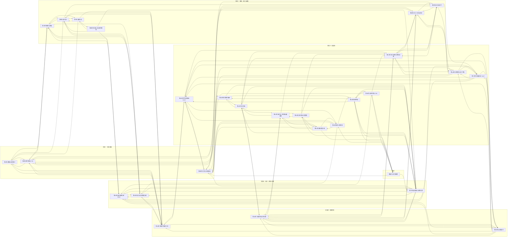

# 知识网络

手册的 27 章不是孤立的知识点，而是互相支撑的一张网。这一页给出整张网的结构，并推荐几条贯穿多章的阅读路径。

> [!NOTE]
> 图中每条箭头表示"阅读后者能更好理解前者"，或"两者在工程中相互影响"。箭头方向不代表先后，具体顺序见[学习路线](../00-学习路线.md)。

---

## 一、整张网的结构

按学习阶段分组，箭头为各章"知识联动"中列出的关系。

---

## 二、三条主线

手册的内容可以沿着三条主线理解。每条主线都会穿过多个阶段。

### 1. 能量流：热量从哪里来，到哪里去

**路径：** 房间热量 → 空气处理 → 冷冻水 → 冷机 → 冷却塔 → 室外。

| 步骤 | 章节 |
| --- | --- |
| 热量如何计算 | [热力学与流体基础](../1-基础理论/03-热力学与流体基础.md) |
| 冷量如何产生 | [制冷循环基础](../4-能量流/冷源/01-制冷循环基础.md)、[冷水机组](../4-能量流/冷源/02-冷水机组.md) |
| 热量如何排出 | [冷却塔、换热器与蓄冷罐](../4-能量流/冷源/03-冷却塔与换热设备.md) |
| 冷量如何输送 | [冷站水系统与联锁逻辑](../4-能量流/水系统/01-冷站水系统与联锁逻辑.md)、[压差控制与水力平衡](../4-能量流/水系统/02-压差控制与水力平衡.md) |
| 冷量如何送到房间 | [空气处理机组](../4-能量流/空气侧/01-空气处理机组.md)、[变风量末端](../4-能量流/空气侧/02-变风量末端.md) |
| 数据中心的特殊要求 | [精密空调](../4-能量流/末端与液冷/01-精密空调.md)、[液冷系统与 CDU](../4-能量流/末端与液冷/02-液冷系统与CDU.md) |

### 2. 信息流：信号从哪里来，怎样变成动作

**路径：** 传感器 → 通信 → 点表 → 控制序列 → 执行器 → 诊断。

| 步骤 | 章节 |
| --- | --- |
| 信号如何采集 | [传感器与测量](../2-感知与执行/01-传感器与测量.md) |
| 信号如何传输 | [通信协议](../3-通信与数据/01-通信协议.md)、[变化值上报与网络负荷](../3-通信与数据/03-变化值上报与网络负荷.md) |
| 信号如何组织 | [点表设计](../3-通信与数据/02-点表设计.md) |
| 信号如何驱动动作 | [闭环控制与 PID](../1-基础理论/02-闭环控制与PID.md)、[控制序列编写方法](../5-控制策略/01-控制序列编写方法.md) |
| 动作如何被验证和诊断 | [调试与功能性能测试](../6-调试与运维/01-调试与功能性能测试.md)、[自动故障诊断（FDD）](../6-调试与运维/02-自动故障诊断FDD.md) |

### 3. 优化主线：如何在满足需求的前提下节能

**路径：** 设定值复位 → 群控 → 能效指标 → 运维记录。

| 步骤 | 章节 |
| --- | --- |
| 设定值如何随负荷变化 | [设定值复位](../5-控制策略/02-设定值复位.md) |
| 多台设备如何协调 | [冷站群控与负荷计算](../5-控制策略/03-冷站群控与负荷计算.md) |
| 节能效果如何衡量 | [能效指标与运维记录](../6-调试与运维/03-能效指标与运维记录.md) |

---

## 三、几条推荐阅读路径

以下路径跨越多个阶段，适合在学完对应章节后尝试。

**路径 A：从一个阀门理解整套系统**

第 2 章 闭环控制与 PID → 第 5 章 执行器与阀门 → 第 14 章 压差控制与水力平衡 → 第 13 章 冷站水系统与联锁逻辑 → 第 24 章 冷站群控。

> 同一个阀门，在控制层面是 PID 的执行器，在水力层面影响管网的流量分配，在系统层面又参与群控决策。

**路径 B：从一度电理解数据中心能效**

第 3 章 热力学与流体基础 → 第 10 章 制冷循环基础 → 第 11 章 冷水机组 → 第 19 章 精密空调 → 第 27 章 能效指标与运维记录。

> 从热力学的能量守恒出发，最终落到 PUE 这一指标上。中间每一步都是一次能量损失或能量转换的机会。

**路径 C：从一个故障理解为什么要做诊断**

第 4 章 传感器与测量 → 第 17 章 变风量末端 → 第 23 章 设定值复位 → 第 25 章 调试与功能性能测试 → 第 26 章 自动故障诊断（FDD）。

> 一台 VAV 风量偏低，可能是传感器漂移、阀门卡滞，也可能是复位逻辑不合理。调试和诊断就是为了把这些可能性一一区分开。

---

## 四、如何使用这张网

- **沿箭头跳转：** 读到一个概念时，先看它的前置章节，再看它的"知识联动"列表。
- **画自己的网：** 学完一个阶段后，尝试用纸笔画出本阶段章节之间的关系，并与本页对照。
- **发现缺口：** 如果你觉得某两章之间的联系没有写清楚，欢迎在仓库中提出修改建议。
